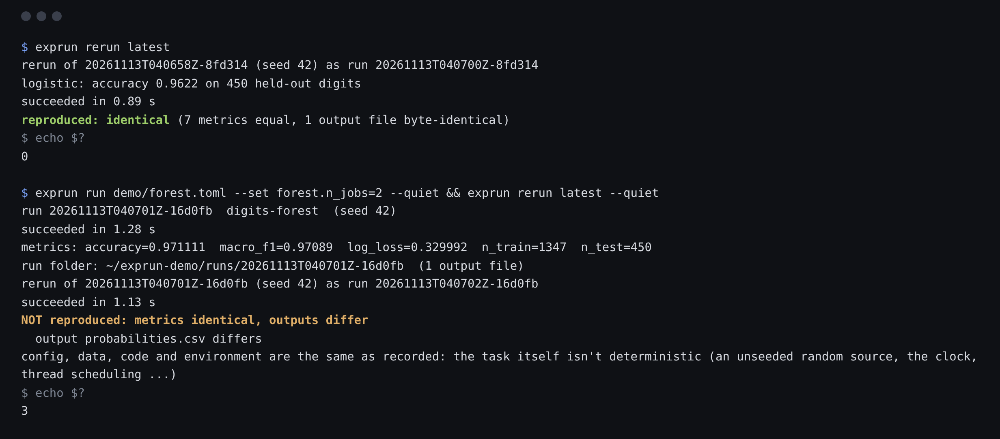
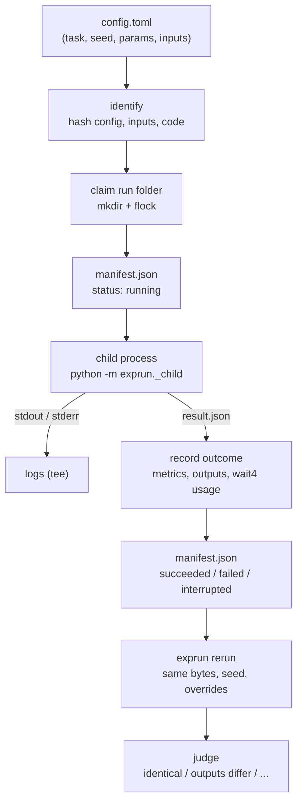

# Reproducible Experiment Runner

[](https://github.com/SohamMessi10/reproducible-experiment-runner/actions/workflows/tests.yml)

`exprun` runs an experiment from a config file and records everything needed to run it again and
check the result: the exact config, content hashes of the data, the seed, the code version
(including uncommitted edits), the Python environment, and the metrics and output files. Then it
reruns past runs and says whether they reproduced and, if not, what changed.



## Why

"I set the seed" is the usual answer to "can you reproduce this?", and it's only part of one. On
the same seed, config and data, I measured each of these changing a result
([details](docs/reproducibility.md)):

| What changed | Outcome |
|---|---|
| Nothing | identical, 5 of 5 reruns (both models) |
| A random forest on 2 cores instead of 1 | metrics identical, output bytes differ on every rerun (1 to 2 [ULP](docs/reproducibility.md)) |
| scikit-learn 1.9.1 → 1.8.0 | logistic regression: metrics identical, 1,164 of 4,500 probabilities differ (up to 60 ULP) |
| Python's per-process string-hash seed (outside exprun) | 4 to 5 different results in 10 runs of a task that iterates a set |
| A task that ignores its seed | different, every time |
| One value in the data file, same file name | refused before running |

A result is only as reproducible as the least-recorded thing it depends on. `exprun` records
those things, fixes the ones it can (the string-hash seed), and tells you which one moved.

## What it does

- **Identifies every run by what determines it.** A fingerprint hashes the config's task, seed and
  params; the content of every input file or folder; and the task's code: its source, the git
  commit and a hash of any uncommitted changes. Two runs with the same fingerprint were asked to
  compute the same thing.
- **Runs the task in its own process** and records: status, metrics, output file hashes, stdout and
  stderr, exit code or signal, CPU time and peak memory, Python and package versions, and the
  thread-count variables that change numerical results.
- **Survives crashes.** The manifest is written atomically before the task starts and after it
  ends. A runner killed with `kill -9` leaves a run that reads as "interrupted", detected from a
  file lock, not left as "running" forever. Ctrl-C, SIGTERM and timeouts stop the task in stages.
- **Reruns and judges.** `exprun rerun` uses the run's saved config bytes, overrides and seed (even
  a randomly drawn one). It refuses changed data, and changed code unless you allow it. It reports
  one of: identical; metrics identical, outputs differ; within tolerance; different; or failed,
  with the metric changes and the environment differences that might explain them.
- **Sweeps a grid of params** with a bounded number of parallel workers, checking every point's
  config before the first run starts.
- **No runtime dependencies:** the standard library only, on Linux and macOS.

## Quick start

Requires Python 3.12 or newer on Linux or macOS.

```bash
git clone https://github.com/SohamMessi10/reproducible-experiment-runner
cd reproducible-experiment-runner
python -m venv .venv && source .venv/bin/activate
pip install -e ".[demo]"         # the demo extra adds NumPy and scikit-learn; exprun itself needs neither
```

The demo writes the handwritten-digits dataset that ships with scikit-learn and two configs. The
output below is real, from a 2-CPU Linux machine, with the home folder shortened to `~`:

```console
$ exprun demo demo
wrote demo/data/digits.csv
wrote demo/data/SOURCE.txt
wrote demo/logistic.toml
wrote demo/forest.toml
next: exprun run demo/logistic.toml

$ exprun run demo/logistic.toml
run 20261113T040658Z-8fd314  digits-logistic  (seed 42)
logistic: accuracy 0.9622 on 450 held-out digits
succeeded in 1.23 s
metrics: accuracy=0.962222  macro_f1=0.96199  log_loss=0.161545  n_train=1347  n_test=450  iterations=72  converged=True
run folder: ~/exprun-demo/runs/20261113T040658Z-8fd314  (1 output file)

$ exprun rerun latest
rerun of 20261113T040658Z-8fd314 (seed 42) as run 20261113T040700Z-8fd314
logistic: accuracy 0.9622 on 450 held-out digits
succeeded in 0.89 s
reproduced: identical (7 metrics equal, 1 output file byte-identical)
```

The line `logistic: accuracy ...` is the task's own output. Run ids start with the UTC start time,
and end with the start of the fingerprint, so the rerun shares its last six characters.

A run that doesn't reproduce exits with code 3 and says why:

```console
$ exprun run demo/forest.toml --set forest.n_jobs=2 --quiet
run 20261113T040701Z-16d0fb  digits-forest  (seed 42)
succeeded in 1.28 s
metrics: accuracy=0.971111  macro_f1=0.97089  log_loss=0.329992  n_train=1347  n_test=450
run folder: ~/exprun-demo/runs/20261113T040701Z-16d0fb  (1 output file)

$ exprun rerun latest --quiet
rerun of 20261113T040701Z-16d0fb (seed 42) as run 20261113T040702Z-16d0fb
succeeded in 1.13 s
NOT reproduced: metrics identical, outputs differ
  output probabilities.csv differs
config, data, code and environment are the same as recorded: the task itself isn't deterministic (an unseeded random source, the clock, thread scheduling ...)
```

With two worker threads, the forest adds up its trees' probabilities in whichever order the
threads finish, and floating-point addition isn't associative.

### A sweep

```console
$ exprun sweep demo/logistic.toml --grid logistic.C=0.01,0.1,1,10 --grid seed=1,2,3 --workers 2 --sort accuracy --descending
sweep 20261113T040704Z-71f165: 12 runs (4 x 3), 2 at a time, swept
( 1/12 done) logistic.C=0.01 seed=2  20261113T040704Z-1d968f  succeeded in 0.74 s  accuracy=0.891111  macro_f1=0.890743  log_loss=1.13128
...
RUN                      logistic.C  seed  STATUS     DURATION  accuracy  macro_f1  log_loss  n_train  n_test  iterations  converged
20261113T040709Z-4f3fc3  10          3     succeeded  0.84 s    0.975556  0.975612  0.105481  1347     450     80          True
20261113T040708Z-6a7095  10          1     succeeded  0.85 s    0.973333  0.973298  0.109712  1347     450     72          True
20261113T040708Z-2ada7d  1           3     succeeded  0.74 s    0.971111  0.971156  0.147568  1347     450     81          True
20261113T040707Z-1e9598  1           1     succeeded  0.75 s    0.966667  0.966573  0.152718  1347     450     77          True
20261113T040709Z-66a56e  10          2     succeeded  0.73 s    0.966667  0.966885  0.110214  1347     450     72          True
20261113T040707Z-7d4969  1           2     succeeded  0.82 s    0.962222  0.96206   0.168362  1347     450     71          True
20261113T040706Z-b9181f  0.1         3     succeeded  0.82 s    0.955556  0.955497  0.357196  1347     450     47          True
20261113T040706Z-ec7bf8  0.1         1     succeeded  0.83 s    0.951111  0.950537  0.367302  1347     450     46          True
20261113T040706Z-618804  0.1         2     succeeded  0.74 s    0.942222  0.942084  0.396116  1347     450     46          True
20261113T040705Z-c470fd  0.01        3     succeeded  0.72 s    0.933333  0.932591  1.10153   1347     450     22          True
20261113T040704Z-d9d988  0.01        1     succeeded  0.90 s    0.924444  0.922924  1.11438   1347     450     21          True
20261113T040704Z-1d968f  0.01        2     succeeded  0.74 s    0.891111  0.890743  1.13128   1347     450     23          True
sweep 20261113T040704Z-71f165: all 12 runs succeeded
```

The seed here also picks the train/test split, and it matters: at `C=0.01`, accuracy ranges from
0.891 to 0.933 across three seeds, and the ranges for `C=1` and `C=10` overlap. One seed per
setting would have ranked them with more confidence than the data supports.

On this 2-CPU machine, the same 12 runs took 15.0 and 15.4 s with one worker, 9.5 and 9.8 s with
two, and 8.9 and 10.1 s with three. The output files were byte-identical with one worker and two.

## Your own experiment

A config names a task, a seed, inputs and params:

```toml
[experiment]
name = "churn-baseline"
task = "train:fit"                 # module:function, found from the config's folder
seed = 42                          # leave it out and exprun draws one and records it
description = "gradient boosting on last quarter's data"

[inputs]
customers = "data/customers.csv"   # a file or a folder; hashed by content

[params]
learning_rate = 0.1
model = { depth = 4, trees = 300 }
```

The task is a plain function. It gets the seed, params, input paths and a folder for outputs, and
returns its metrics: a flat dictionary of finite numbers, booleans or strings.

```python
# train.py, next to the config (a sketch: load, train, save and score are yours)
def fit(ctx):
    rows = load(ctx.inputs["customers"])
    model = train(rows, seed=ctx.seed, **ctx.params["model"])
    save(model, ctx.output_dir / "model.bin")       # kept with the run and hashed
    return {"auc": score(model, rows)}
```

```bash
exprun check experiment.toml                       # validate, and show what would identify the run
exprun run experiment.toml --set learning_rate=0.05
```

`--set` and `--grid` take TOML values, so strings need quotes (`--set 'model="xgb"'`), and `1`
and `1.0` are different values: write `1.0` to keep a float param a float.

## Commands

| Command | What it does |
|---|---|
| `exprun check CONFIG [--set K=V]` | Validate a config; show its fingerprint, inputs and code version |
| `exprun run CONFIG [--set K=V] [--timeout S] [--quiet]` | Run and record |
| `exprun sweep CONFIG --grid K=V1,V2 [--grid ...] [--workers N] [--sort M [--descending]]` | Run every combination, N at a time |
| `exprun sweep-results [SWEEP] [--sort M] [--json]` | Show a past sweep's table |
| `exprun list [--experiment NAME] [--status S] [--limit N] [--json]` | List runs, newest first |
| `exprun show RUN [--json]` | Everything recorded about one run |
| `exprun compare RUN RUN... [--all] [--json]` | What differs between runs: params, inputs, code, environment, metrics |
| `exprun rerun RUN [--tolerance REL] [--allow-code-change]` | Run again and judge whether it reproduced |
| `exprun demo FOLDER` | Write the demo data and configs |

`RUN` is a run id, a unique start of one, or `latest`. Every command except `check` and `demo`
takes `--runs FOLDER` (default `./runs`).

| Exit code | Meaning |
|---|---|
| 0 | Done: the run succeeded, the sweep's runs all succeeded, the rerun reproduced |
| 1 | A run failed or was interrupted, or a file couldn't be read or written |
| 2 | Bad usage: an invalid config, a missing task or input, a refused rerun |
| 3 | The rerun ran but didn't reproduce |

## How it works



Each run gets a folder:

```text
runs/20261113T040658Z-8fd314/
├── manifest.json      everything recorded, rewritten atomically
├── config.toml        the config's exact bytes
├── stdout.log
├── stderr.log
└── outputs/           files the task wrote to ctx.output_dir
```

The choices that matter most (more in [docs/design.md](docs/design.md)):

- **Hash by content, not by name or modification time.** Inputs are hashed byte for byte; a folder
  is hashed from its sorted file list. A data file rewritten under the same name changes the
  fingerprint, and a rerun refuses it.
- **Canonical config hashing.** The params are hashed as canonical JSON, so reformatting the TOML
  or reordering keys doesn't change a run's identity, while changing `1.0` to `1` does.
- **Code version without importing the task.** The module is located on the import path and
  checked with `ast` for the function, so `exprun check` doesn't run your code. In a git checkout
  the record has the commit, whether the tree is dirty, and a hash of `git diff HEAD`.
- **A run in progress holds a file lock** (`flock`), passed to the child so it stays held until both
  processes end. A "running" manifest whose lock is free belongs to a runner that died.
- **`os.wait4` reaps the child** to get its own CPU time and peak memory, not the runner's.
- **Stopping in stages.** Ctrl-C reaches the task directly, so the runner gives it 5 s to record
  its interruption, then sends SIGTERM, then SIGKILL; a second Ctrl-C kills at once.
- **The task's bytecode is compiled in checked-hash mode** (PEP 552). Python's default cache
  trusts a file's modification time in whole seconds plus its size, so a same-size edit within a
  second ran the old code while the manifest recorded the new source. A flaky test found that.
- **`PYTHONHASHSEED=0` for the task,** so iterating a set of strings repeats from run to run.

## Testing

- **312 tests** on Python 3.12, 3.13 and 3.14 on Linux, and 3.13 on macOS, in
  [GitHub Actions](.github/workflows/tests.yml).
- **Real processes and signals:** Ctrl-C to the process group, SIGTERM, `kill -9` of the runner,
  tasks that ignore SIGTERM, time limits, and a sweep stopped mid-run.
- **Real git repositories** for the code-version checks, and the demo end to end with scikit-learn.
- **Hypothesis property tests:** for example, key order never changes a hash while any changed
  value does, and any grid value reads back exactly after being written as an override.
- **Mutation testing:** 156 deliberate bugs planted across the five milestones. 137 failed a test
  at once. 16 survived because of real test gaps, which now have tests, and 3 sat in code that
  couldn't run, now removed.

```bash
pip install -e ".[dev,demo]"
pytest
ruff check src tests scripts
python scripts/nondeterminism.py      # re-measures the table in "Why"
```

## Security and privacy

- **Your task is your code:** `exprun` runs it with your permissions, like `python train.py` would.
  Run configs you trust.
- **No secrets are recorded:** of the environment, only Python, the platform, installed package
  versions and a fixed list of variables (`PYTHONHASHSEED`, BLAS/OpenMP thread counts,
  `CUDA_VISIBLE_DEVICES`) go into a manifest, never the whole environment.
- **Manifests contain absolute paths** to the config and inputs, which can include your user name.
  Check before sharing a runs folder.

## Limitations

- **Linux and macOS only:** the run lock uses `fcntl`.
- **A rerun needs the same checkout.** It reads the task from the config's original path, so a runs
  folder copied to another machine can be inspected and compared, but not rerun as is.
- **The environment is Python's.** Package versions and thread settings are recorded; the BLAS
  library, CPU model, GPU and drivers are not. Two machines can match on everything recorded and
  still differ.
- **One machine, one grid.** Sweeps are a full grid on local cores. No random or adaptive search,
  no cluster, no remote store or UI. Tools like MLflow do those; this project is about the record
  and the rerun.
- **Outputs are hashed after every run,** which takes time for very large output files.

## Project history

Built in six milestones, each a pull request: config and fingerprint, the runner, inspection and
comparison, reruns, sweeps, and this write-up. [PROGRESS.md](PROGRESS.md) records what each one
changed, how it was checked, and the bugs found along the way.

## Data and license

The demo's handwritten digits are the UCI Optical Recognition of Handwritten Digits test set
(Alpaydin and Kaynak, 1998, [doi:10.24432/C50P49](https://doi.org/10.24432/C50P49)), CC BY 4.0, as
shipped with scikit-learn. The code is MIT licensed: see [LICENSE](LICENSE).
